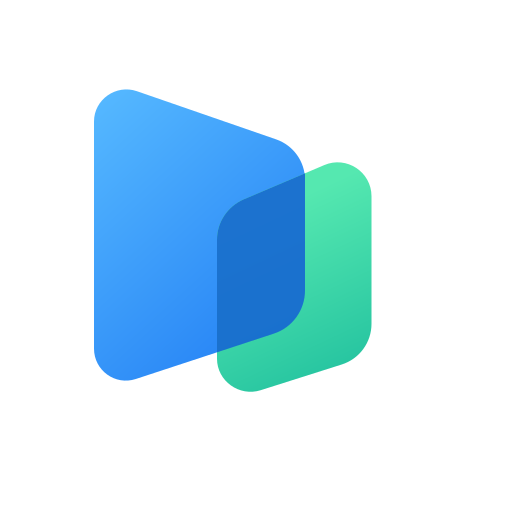
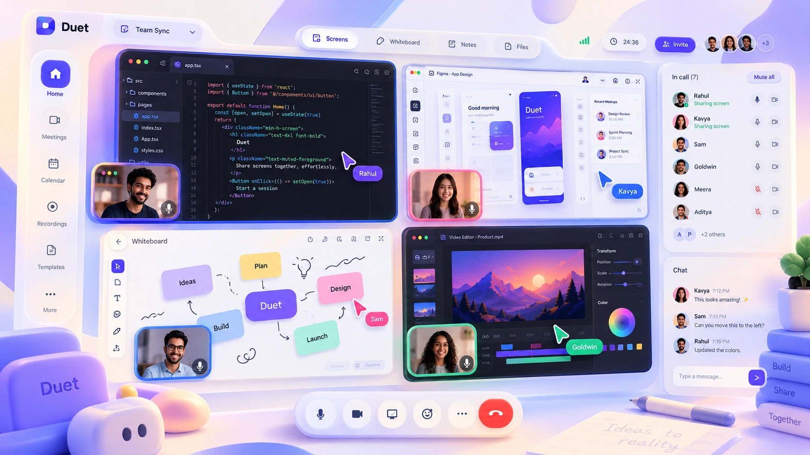
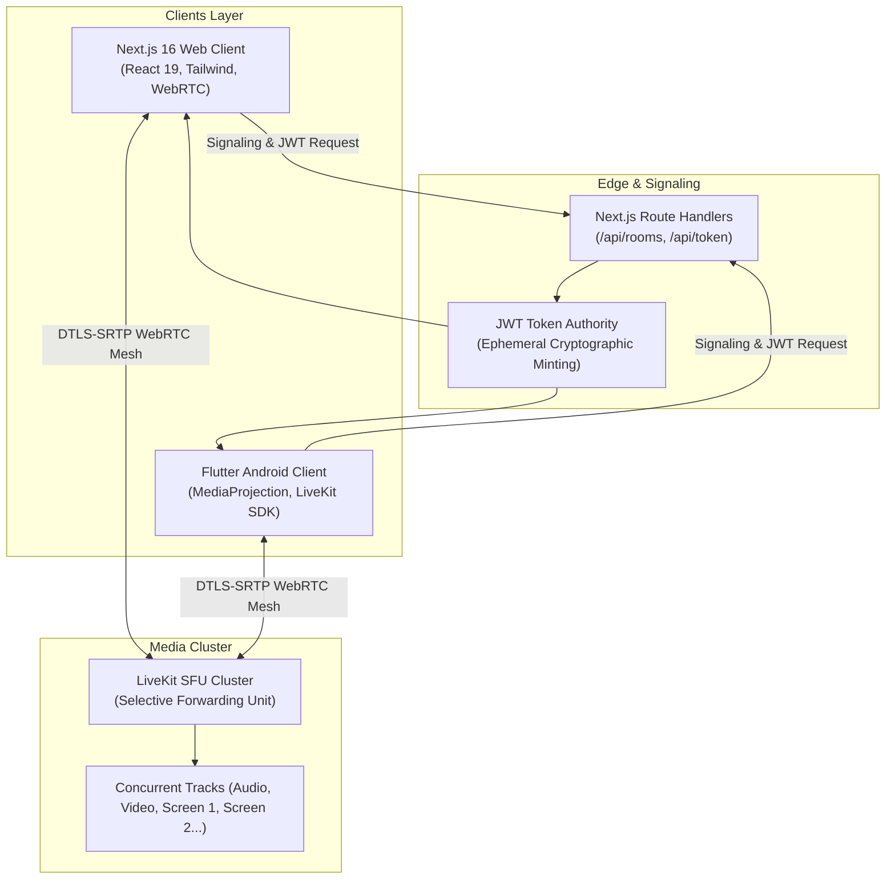

<div align="center">

  

  # Duet

  ### **Every screen. One conversation.**
  **The open-source video meeting platform engineered for simultaneous multi-screen sharing.**

  <p align="center">
    Stop taking turns sharing screens. Duet allows multiple presenters to stream their screens side-by-side in real time with sub-50ms latency, zero accounts required, and zero video stored on servers.
  </p>

  <div>
    <a href="https://duetxmeet.vercel.app">
      
    </a>
    <a href="https://duetxmeet.vercel.app/duet.apk">
      
    </a>
    <a href="https://github.com/rahulpandiyan/duet-meet/stargazers">
      
    </a>
    <a href="LICENSE">
      
    </a>
  </div>

  <br />

  <div>
    
    
    
    
    
    
  </div>

  <br />

  <a href="https://duetxmeet.vercel.app">
    
  </a>

  <sub><i>Live session preview: Multiple team members sharing code editor, mobile app simulator, Figma design, and whiteboard concurrently.</i></sub>

</div>

---

## ⚡ Why Duet?

In modern software development and design, work happens in parallel. But legacy video conferencing software (Google Meet, Zoom, Microsoft Teams) forces teams into a **Single-Presenter Bottleneck**:

> *"Can you stop sharing so I can share my screen?"*  
> *"Wait, which tab was that on?"*  
> *"Let me switch windows to show the terminal..."*

Taking turns sharing screens destroys focus and drags out meetings. **Duet changes that fundamentally.**

With Duet, **multiple participants broadcast their screens at the exact same time**. You can view an API terminal alongside the frontend UI, inspect Figma mockups side-by-side with staging builds, or run an Android simulator directly next to backend server logs.

---

## 🚀 Key Features

### 🖥️ Simultaneous Multi-Screen Sharing
- Multiple presenters publish independent, concurrent 60 FPS WebRTC screen tracks.
- Starting a screen share never interrupts or overrides other active presenters.
- Real-time resolution, frame rate, and latency telemetry per stream.

### 📱 Native Flutter Android App
- Companion mobile app (`duet_meet`) with background screen capture (`MediaProjection` foreground service).
- Stream mobile workflows directly into the room alongside desktop screens.
- Persistent microphone and camera preferences across app launches.
- Available as a direct release APK download: [**Download Duet APK**](https://duetxmeet.vercel.app/duet.apk).

### 🔲 3 Interactive Viewport Layouts
- **Grid Layout**: Balanced, symmetrical split-screen view for pair programming and side-by-side comparisons.
- **Focus Layout**: Spotlight any primary screen while retaining live thumbnail feeds of secondary presenters.
- **Wall Layout**: Ultra-wide panoramic stream canvas for DevOps war rooms and team hackathons.

### 🔒 Zero-Friction & Zero-Storage Privacy
- **No Account Required**: Create or join instant meetings with a 9-letter code (`ABC-DEF-GHI`).
- **Zero Cloud Storage**: Meeting media is routed in-memory via WebRTC SFU; video, audio, and screens are never recorded or stored on our servers.
- **Peer DTLS-SRTP Encryption**: Bank-grade end-to-end media encryption.

### 🛡️ Host Moderation & Security
- Instant room locking to prevent unexpected guests.
- Presenter permission controls (allow everyone or host-only sharing).
- Participant muting and removal tools.
- Real-time in-meeting chat.

---

## 📊 Comparison Matrix

| Capability | Duet | Google Meet | Zoom | Microsoft Teams |
| :--- | :---: | :---: | :---: | :---: |
| **Concurrent Screen Sharing** | ✅ **Unlimited / Multi-screen** | ❌ Single only | ❌ Add-on / Fragile | ❌ Single only |
| **Account / Sign-Up Required** | ❌ **None (Instant Guest)** | ✅ Google Account | ✅ Zoom Account | ✅ Microsoft Account |
| **Software Download Required** | ❌ **Browser / Optional APK** | ❌ Browser | ⚠️ Desktop App | ⚠️ Heavy Client |
| **Sub-50ms WebRTC Latency** | ✅ **Yes (LiveKit SFU)** | ⚠️ 150ms+ | ⚠️ 120ms+ | ⚠️ 180ms+ |
| **Zero Server Media Storage** | ✅ **100% Ephemeral** | ❌ Cloud logged | ❌ Cloud logged | ❌ Cloud logged |
| **Open Source (MIT)** | ✅ **Yes** | ❌ Proprietary | ❌ Proprietary | ❌ Proprietary |

---

## 🏗️ Architecture & Technology Stack



- **Frontend Web**: [Next.js 16](https://nextjs.org/) (App Router, Turbopack, React 19), [Tailwind CSS](https://tailwindcss.com/), [Framer Motion](https://www.framer.com/motion), [Lucide React](https://lucide.dev/).
- **Mobile Client**: [Flutter 3.29](https://flutter.dev/) (Dart 3), `livekit_client`, `flutter_webrtc`, Android Foreground Service.
- **Media Engine**: [LiveKit SFU](https://livekit.io/) with DTLS-SRTP encryption, simulcast, and adaptive bitrate control.
- **Deployment**: [Vercel Edge Network](https://vercel.com/) & LiveKit Cloud / Self-hosted SFU.

---

## ⚡ Quick Start Guide

### Prerequisites
- [Node.js](https://nodejs.org/) v20+ or v22+
- [Git](https://git-scm.com/)
- *(Optional for Mobile)*: [Flutter SDK](https://docs.flutter.dev/get-started/install) v3.29+ and Android Studio

---

### 1. Run the Web Application

```bash
# 1. Clone the repository
git clone https://github.com/rahulpandiyan/duet-meet.git
cd duet-meet

# 2. Install dependencies
npm install

# 3. Setup environment variables
cp .env.example .env.local

# 4. Start local LiveKit development server (in a separate terminal)
npm run livekit

# 5. Start Next.js development server
npm run dev
```

Visit [http://localhost:3000](http://localhost:3000) in your browser.

---

### 2. Run the Flutter Android App

```bash
cd duet_meet

# Get Flutter dependencies
flutter pub get

# Run on a connected Android device or emulator
flutter run

# Or build a production release APK
flutter build apk --release --split-per-abi
```

The release APK will be located at `duet_meet/build/app/outputs/flutter-apk/app-arm64-v8a-release.apk`.

---

## 🔧 Environment Configuration

Create a `.env.local` file in the root directory:

```env
# LiveKit Server Connection
NEXT_PUBLIC_LIVEKIT_URL=ws://localhost:7880
LIVEKIT_URL=http://localhost:7880
LIVEKIT_API_KEY=devkey
LIVEKIT_API_SECRET=secret

# For Production (e.g., LiveKit Cloud)
# NEXT_PUBLIC_LIVEKIT_URL=wss://your-project.livekit.cloud
# LIVEKIT_URL=https://your-project.livekit.cloud
# LIVEKIT_API_KEY=your_api_key
# LIVEKIT_API_SECRET=your_api_secret
```

---

## 📁 Repository Structure

```
duet-meet/
├── app/                        # Next.js 16 App Router
│   ├── api/                    # Serverless API routes (token, rooms, host controls)
│   ├── create/                 # Instant room creator
│   ├── join/                   # Meeting code joiner
│   ├── lobby/[code]/           # Pre-flight camera/mic/audio test lobby
│   ├── room/[code]/            # Live meeting room with multi-screen grid
│   ├── help/                   # Help center & guides
│   ├── security/               # Cryptographic security whitepaper
│   ├── status/                 # Real-time infrastructure status
│   ├── terms/                  # Terms of service
│   ├── privacy/                # Privacy policy
│   ├── manifest.ts             # Web App Manifest generator
│   ├── robots.ts               # Robots.txt generator
│   └── sitemap.ts              # XML Sitemap generator
├── components/                 # Reusable UI components & layouts
│   ├── ui/                     # Design tokens, claymorphic buttons & cards
│   ├── HeroPreview.tsx         # High-resolution hero showcase
│   └── LegalLayout.tsx         # Unified light documentation template
├── duet_meet/                  # Flutter Android companion application
│   ├── lib/
│   │   ├── screens/            # Meeting room, create, join, lobby screens
│   │   ├── widgets/            # Settings sheet, screen tiles, control docks
│   │   └── services/           # LiveKit client, screen capture service
│   └── android/                # Android native project & manifest
└── public/                     # Static assets, hero preview, APK downloads
```

---

## 🗺️ Roadmap

- [x] Web client with simultaneous multi-screen WebRTC sharing
- [x] Grid, Focus, and Wall layout modes
- [x] Host moderation controls (lock room, mute, host-only sharing)
- [x] In-meeting peer chat
- [x] Flutter Android client with `MediaProjection` background capture
- [x] Release APK generation and direct download distribution
- [x] SEO optimization, structured JSON-LD schema, OpenGraph, sitemap & robots
- [ ] iOS companion client (`duet_meet_ios`)
- [ ] Real-time canvas annotations over active presenter screens
- [ ] Selective tab audio streaming alongside video capture
- [ ] End-to-end user encryption (E2EE) with insertable streams

---

## 🤝 Contributing

Contributions are what make open source an amazing place to learn, inspire, and create. Any contributions you make are **greatly appreciated**!

1. Fork the Project
2. Create your Feature Branch (`git checkout -b feature/AmazingFeature`)
3. Commit your Changes (`git commit -m 'Add some AmazingFeature'`)
4. Push to the Branch (`git push origin feature/AmazingFeature`)
5. Open a Pull Request

---

## 📄 License

Distributed under the **MIT License**. See [`LICENSE`](LICENSE) for more information.

---

## 👨‍💻 Author & Attribution

**Duet** is designed and engineered with ❤️ by **Rahul Pandiyan**.

- Website: [duetxmeet.vercel.app](https://duetxmeet.vercel.app)
- GitHub: [@rahulpandiyan](https://github.com/rahulpandiyan)

---

<div align="center">
  <p>⭐ <b>Star this repository if you find it helpful!</b> It helps other developers find Duet.</p>
</div>
